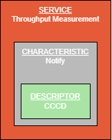
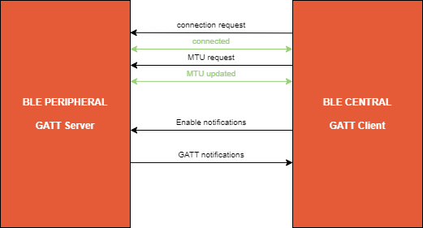
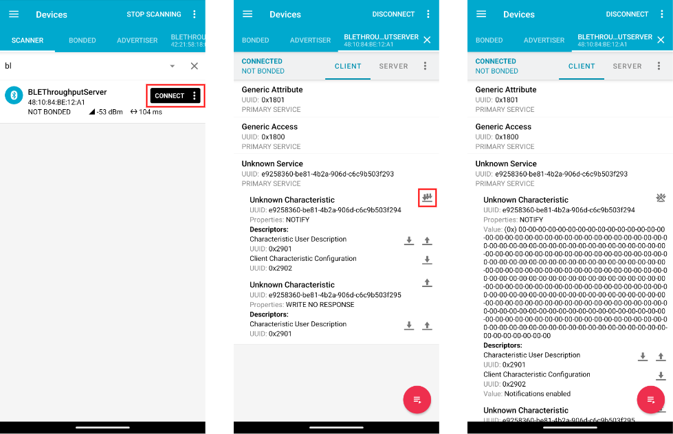
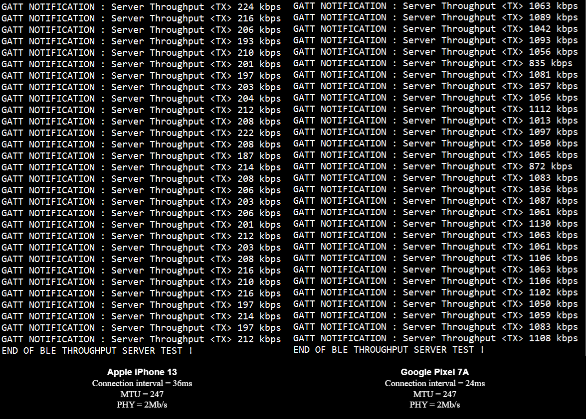

# Bluetooth® LE GATT Server TX throughput

This application  demonstrates the maximum Bluetooth® LE throughput (using GATT layer notifications) that can be obtained with the MicroEJ Bluetooth API library.

Note : This application is not here to help you to develop the LLBLUETOOTH APIs, consider it as a benchmark of the Bluetooth® LE capabilities of your board within the MicroEJ abstraction layer.

## Requirements

- MicroEJ SDK6
- A VEE Port with bluetooth pack
- All the LLBLUETOOTH APIs concerning the Peripheral role and GATT Server shall be tested and validated.

## Overview

With this application, the device acts as a Bluetooth® LE GAP Peripheral and GATT Server, it sends the maximum GATT notifications possible to a BLE Central device and calculates each second the Bluetooth® LE TX throughput. The throughput test starts when the client enables the notifications and it stops after 30 seconds. The application can be tested with any iOS/Android app acting as Bluetooth® LE Central, we recommend you to use nRF Connect.

Advertising name = `BLEThroughputServer`

The GATT Server has a custom service called "Throughput Measurement". This service has a characteristic, simply called Notify. The Notify characteristic has a Client characteristic configuration descriptor (CCCD).

**Figure 1 : Throughput Measurement service**

The GATT Throughput measurement is very simple, the application counts the number of data packets that have been sent in 1 second and then calculates the throughput according to this formula :

`GATT throughput = (number of packets * number of bytes in each packet * 8 bits)/1000 kbps`

We highly recommend you to log these parameters in your BLE Stack :
- Connection interval
- MTU updated
- PHY used

**Figure 2 : Data transfer process**

### Using nRF Connect iOS/Android app on smartphone as Bluetooth® LE Central

1. Connect your board to the PC as your setup requires.
2. Open any serial terminal to display the logs.
3. Launch the nRF Connect app and start scanning (you can add a filter).
4. When 'BLEThroughputServer' appears, click on Connect.
5. In the 'Throughput Measurement' service, click on the triple-arrows to enable the notifications.
6. Once clicked, the test starts and the current throughput is displayed each second in the terminal.

**Figure 3 : nRF Connect app**

As an example, you can see below the test with 2 different devices in the Central Role.

Context :
- MCU ATS3085S which embeds Bluetooth
- Zephyr Stack v2.7 with some slight vendor alteration
- PHY automatically updated to 2Mb/s
- Allowed ATT MTU = 247

**Figure 4 : Terminal output**

You may notice differences in the TX Throughput between multiple devices. Depending of your client device, the Bluetooth® LE throughput can be limited due to some parameters (connection interval, number of BLE packets per connection interval, MTU ...).

### How you can improve your throughput

This test can be seen as a qualification of the Bluetooth® LE, so it is important to optimize its throughput

This link below gives you some advices that can help you to improve your throughput :
https://docs.microej.com/en/latest/ApplicationDeveloperGuide/bluetoothAPI.html#achieving-maximum-throughput

Please, note that this application is designed to reach the maximum Bluetooth® LE throughput possible. The two ways of improving the throughput are modifying parameters in the BLE stack or in the client side.

## Run on Device

Make sure to properly setup the VEE Port environment before going further.
Refer to the VEE Port README for more information.

In Android Studio:
- Open the Gradle tool window by clicking on the elephant on the right side,
- Expand the `Tasks` list,
- From the `Tasks` list, expand the `microej` list,
- Double-Click on `runOnDevice`.
- The device is flashed. Use the appropriate tool to retrieve the execution traces.

Alternative ways to run on device are described in the [Run on Device](https://docs.microej.com/en/latest/SDK6UserGuide/runOnDevice.html) documentation.

---
_Copyright 2024-2026 MicroEJ Corp. All rights reserved._  
_Use of this source code is governed by a BSD-style license that can be found with this software._

